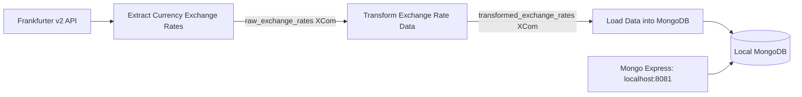

# Daily Currency Exchange ETL

An Astro CLI / Apache Airflow project that fetches Frankfurter v2 exchange rates,
transforms them, and saves them to a **local MongoDB**. Mongo Express provides the
local administration interface. The DAG has exactly three tasks.



## Prerequisites

- Docker Engine / Docker Desktop with Compose and enough memory for Airflow.
- [Astro CLI](https://www.astronomer.io/docs/astro/cli/install-cli).
- Internet access for Docker images and the public Frankfurter API.

This project uses Astro Runtime `3.3-12`. The DAG runs daily at **07:15
Asia/Karachi (02:15 UTC)**. It requests the latest published rates and preserves
each API row's publication date, which may be earlier than the execution date.
The default currency configuration is EUR to USD, GBP, and JPY.

## Start locally

```bash
git clone https://github.com/saadzafar0/airflow-etl.git
cd airflow-etl
cp .env.example .env
astro dev start --no-proxy --wait 5m
```

Astro automatically merges `docker-compose.override.yml` with its generated
Airflow services and loads `.env` into the Airflow containers. Edit `.env` to
change the local credentials or currencies. The checked-in example credentials
are intended for this local assignment.

- Airflow: <http://localhost:8080> (the local login is printed by Astro).
- Mongo Express: <http://127.0.0.1:8081>; use `MONGO_EXPRESS_USERNAME` and
  `MONGO_EXPRESS_PASSWORD` from `.env`.
- MongoDB has **no published host port**. Its hostname inside Docker is `mongodb`.

Unpause the DAG and trigger an initial run in Airflow, or run:

```bash
astro dev run dags unpause currency_exchange_etl
astro dev run dags trigger currency_exchange_etl
```

The graph must show these three tasks succeeding in sequence:

1. `extract_currency_exchange_rates`: HTTP GET with explicit connect/read timeouts;
   publishes `raw_exchange_rates` containing API rows and a UTC retrieval timestamp.
2. `transform_exchange_rate_data`: pulls the named raw XCom, validates the complete
   response, maps it to the required schema, and publishes `transformed_exchange_rates`.
3. `load_data_into_mongodb`: pulls the named transformed XCom, creates the unique
   currency-pair/date index, and performs upserts. Publishes `mongo_load_summary`.

Automatic return-value XComs are disabled; every payload uses an explicit key and
every pull specifies the producing task. A failure retries twice after one minute.
Only one DAG run can be active at a time, and historical catchup is disabled.

## Stored schema

```json
{
  "base_currency": "EUR",
  "target_currency": "USD",
  "exchange_rate": 1.15,
  "rate_date": "2026-11-04",
  "source": "Frankfurter API",
  "retrieved_at": "2026-11-05T07:15:00+00:00"
}
```

This is an illustrative record. Actual values come from the API. MongoDB adds
its own `_id`. The application stores all six required fields; the two dates
remain ISO strings and the rate is numeric. The compound unique index on
`(base_currency, target_currency, rate_date)` prevents duplicates across repeated
runs and retries. A later retrieval of the same published rate updates that
record and its retrieval timestamp.

The transformation rejects missing currencies, unexpected bases/targets,
duplicate targets, invalid dates, future publication dates, timezone-free
retrieval timestamps, and nonpositive/nonfinite/nonnumeric rates.

## Docker networking and storage

`currency-db` is an internal bridge network shared by the Airflow scheduler,
MongoDB, and Mongo Express. The scheduler also retains Astro's default network
for API access. Mongo Express publishes only `127.0.0.1:8081`; MongoDB publishes
no port. The database runs on this computer; no Atlas/cloud database is used.

Named volumes `mongodb-data` and `mongodb-config` persist `/data/db` and
`/data/configdb`. `astro dev stop` preserves data. Avoid volume deletion when
you want to retain records. Dockerfile OCI labels and service labels describe
networking and storage.

## Validation

Run the data-validation tests and real DAG import tests in Astro:

```bash
astro dev pytest
astro dev run dags list-import-errors
```

For fast tests without installing Airflow on your host:

```bash
python3 -m venv .venv
.venv/bin/pip install -r requirements-dev.txt
.venv/bin/python -m pytest -q
```

The Airflow import test skips on a host without Airflow. The data tests mock
HTTP responses; live integration evidence is captured separately in the report.
To inspect loaded records, open Mongo Express, select `currency_exchange`, and
open `exchange_rates`. Trigger the DAG a second time and verify that there is
still one document per currency pair and publication date.

## Report

Current verification: **31 tests passed locally and in GitHub Actions**, including
parsing the real DAG with Airflow 3.3.2. A live Frankfurter request produced three
valid transformed records. Full Astro/MongoDB execution remains
unverified here because Docker registry downloads repeatedly timed out. The PDF
includes actual output and records this limitation. The
[successful CI run](https://github.com/saadzafar0/airflow-etl/actions/runs/43206246635)
is available on GitHub.

The submission PDF is `reports/airflow_etl_report.pdf`. Its source screenshots
and captured runtime evidence are under `reports/evidence/`. The report clearly
distinguishes actual output from configuration and source code.

`scripts/build_report.py` rebuilds the PDF from the available evidence.
`scripts/capture_report.py` captures source/output pages with an installed Firefox
binary; it accepts `--firefox /path/to/firefox` for custom installations.

## References

- [Frankfurter API](https://frankfurter.dev/)
- [Airflow named XComs](https://airflow.apache.org/docs/apache-airflow/stable/core-concepts/xcoms.html)
- [Astro Runtime release notes](https://www.astronomer.io/docs/runtime/runtime-release-notes)
- [MongoDB official Docker image](https://hub.docker.com/_/mongo)
